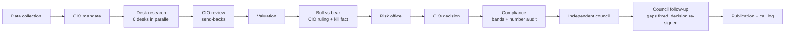

# AlaDeen Capital Research

**An AI research firm for Indian listed companies (NSE / BSE), run from your own computer.**

Type `aladeen TCS` in a terminal. A dashboard opens in your browser. You watch an AI Chief Investment Officer
brief a team of research desks, review and send back their work, referee a bull-vs-bear debate, consult the
risk office and sign an institutional-grade report. You read the finished report in the dashboard and download
it as HTML or PDF. Every research you run is kept in your archive, and every rating goes into a call log that
is later scored against the Nifty 50.

One hard rule runs through the firm: **AI models never do arithmetic.** Every figure is fetched and computed by
code, reconciled and audited. If an agent writes a number it was not given, the report flags it.

> ⚠️ Educational software. Not investment advice. Not SEBI-registered research. See [Disclaimer](#disclaimer).

---

## Quick start

You need **Python 3.11 or newer** and **Git**. Check with `python --version` (on macOS/Linux: `python3 --version`).
Run the commands **one line at a time**.

### Windows — PowerShell

```powershell
git clone https://github.com/adivseth/AlaDeen-Capital-Research.git
cd AlaDeen-Capital-Research
python -m venv .venv
.venv\Scripts\Activate.ps1
pip install -e .
aladeen demo
```

If activation says *"running scripts is disabled on this system"*, run
`Set-ExecutionPolicy -Scope Process -ExecutionPolicy Bypass` (this window only) and repeat the activate line.

### Windows — Command Prompt (cmd)

```bat
git clone https://github.com/adivseth/AlaDeen-Capital-Research.git
cd AlaDeen-Capital-Research
python -m venv .venv
.venv\Scripts\activate.bat
pip install -e .
aladeen demo
```

### macOS / Linux

```bash
git clone https://github.com/adivseth/AlaDeen-Capital-Research.git
cd AlaDeen-Capital-Research
python3 -m venv .venv
source .venv/bin/activate
pip install -e .
aladeen demo
```

### After installing (all systems)

- `aladeen demo` opens the dashboard and shows the firm researching a synthetic company — no API key needed.
- Open **Settings** in the dashboard, pick an AI provider and paste its API key.
- Then research a real company: `aladeen TCS`
- Next time, open a new terminal, `cd` into the folder and activate the environment again (the activate line
  for your system) before using `aladeen`. Your prompt shows `(.venv)` when it is active.
- To get the latest version, see [Updating](#updating) below.

## Updating

Your settings, API keys and past research live in your home folder (`~/.aladeen`), not in the repo, so updating
never touches them. Close any running `aladeen` window first (Ctrl+C), then run the commands for your system.
The `cd` line assumes you cloned into your home folder; if you cloned elsewhere, `cd` into that folder instead.

### Windows — PowerShell

```powershell
cd $HOME\AlaDeen-Capital-Research
.venv\Scripts\Activate.ps1
git pull
pip install -e .
```

### Windows — Command Prompt (cmd)

```bat
cd %USERPROFILE%\AlaDeen-Capital-Research
.venv\Scripts\activate.bat
git pull
pip install -e .
```

### macOS / Linux

```bash
cd ~/AlaDeen-Capital-Research
source .venv/bin/activate
git pull
pip install -e .
```

If `git pull` says your local changes would be overwritten (for example, you edited a file in the repo), run
`git stash` and then `git pull` again. `git stash` sets your edits aside; `git stash pop` brings them back.

## The dashboard

| Page | What it does |
|---|---|
| **Desk** | Enter a ticker (TCS, RELIANCE, 532540…) and an analysis date, or try the demo. |
| **Floor** | The firm at work: every agent at its desk with its current task, memos travelling between desks in pneumatic capsules, the process tracker and a live wire of what each desk is saying. |
| **Report** | The finished report inside the dashboard, with **PDF** (browser print → Save as PDF) and **HTML** downloads, the full research file, and the raw data. |
| **Archive** | Every research you have run, searchable by company and rating. Open, re-download or delete. A research that stopped has a **Try again** button. |
| **Ledger** | Every published rating; **Score my calls** updates prices and reports hit rate and alpha vs the Nifty 50. |
| **Settings** | AI provider and models (see [AI providers](#ai-providers)), API keys, which desks to use, revision and debate rounds, council on/off, document reading, valuation inputs, report branding. |

**When a research fails** (no credit, a rate limit, a closed dashboard), click **Try again** on the run page or in the archive, or run `aladeen retry`. The same research continues: every AI answer already received is kept and reused, so only the unfinished work is run and paid for. You may change the provider or key in Settings first.

Everything stays on your computer: settings in `~/.aladeen/settings.json` (readable only by you), research in
`~/.aladeen/research/`, the archive in `~/.aladeen/aladeen.db`.

## Research monitor

Open **Monitor** from a completed Archive row. Pin a signed baseline, refresh filings and results, then inspect each new disclosure beside the thesis invalidation condition. **Start targeted research review** checks the latest refresh against the signed thesis, forecasts and model inputs. Unchanged evidence closes without an AI call. For ordinary changes, a single assessment can retain the prior call with a recorded reason or route a valuation update to the affected desk and fundamentals. Routine runs keep the opening bull and bear cases, skip rebuttals and omit the council unless the rating band changes and council is enabled in Settings. Governance signals and threatened theses use the configured deep-review settings. Reopening the same evidence reuses its assessment. First coverage follows your normal settings.

When corrected evidence affects valuation or risk, the CIO revisits those dependencies before signing. The report and its research JSON record changed engine inputs, fair value and target price. Refreshes use the announcements available on the company page. A match calls for analyst review.

- **Earnings** compares reporting periods and revisions, earlier report assumptions and target prices. Record an expected metric for an upcoming quarter before observing the actual. Annual revenue forecasts come from the archived DCF where available.
- **Evidence** lets you choose the original financial tables or a later dated refresh. New HTML reports link their financial statements to the captured source rows. Full data collections also save point-in-time FactPacks locally. A historical run selects the latest pack collected by the requested date and stops if no eligible snapshot exists. Historical replay starts with snapshots collected by this version.
- **Valuation** filters industry peers and ranks archived companies by available sector metrics. Change the company-specific equity premium to recalculate the archived assumptions using the current engine settings.
- **Governance** highlights disclosures mentioning auditor changes, audit opinions, promoter pledges and related parties, and compares cash from operations with reported profit.
- **Portfolio** accepts INR allocations against filed calls and a benchmark symbol per holding. Performance uses common adjusted closing prices for a buy-and-hold portfolio with a common inception after publication. It shows holding contributions, sector weights and peak-to-trough drawdown. The Ledger also compares stock, broad index and sector benchmark returns using provider-adjusted series. Price indices exclude dividends unless a total-return series is selected.

## The firm

The **CIO** is the orchestrator. It decides what to investigate, reviews every memo, and signs the call.

| Room | Agent | Job |
|---|---|---|
| Executive Suite | 🧭 Chief Investment Officer | Writes the research mandate (key questions + a brief per desk), reviews memos and sends weak ones back, rules on the debate, signs the final call. |
| Research Floor | 📊 Financial Statements Analyst | 10 years of P&L, balance sheet and cash flow; earnings quality and red flags. |
| | 🏭 Sector & Strategy Analyst | Business model, industry, moat, competition. |
| | ⚖️ Governance & ESG Analyst | Promoters, related parties, auditors, shareholding, ESG. |
| | 📑 Filings & Earnings-Call Analyst | Annual reports and concall transcripts. |
| | 📰 Market Intelligence Analyst | News and announcements. |
| | 📈 Technical Strategist | 10-year chart: 50/200-DMA, Bollinger, RSI, MACD, ADX; 5–10 day short-term check. |
| Valuation Lab | 🗄️ Data & Quant Desk | Collects data, reconciles statements, runs every calculation (no AI). |
| | 🧮 Valuation Analyst | Proposes growth, margin, reinvestment and scenario assumptions; the engine computes the DCF, peers, Graham checks and scenarios. |
| Debate Room | 🐂 Bull Advocate · 🐻 Bear Advocate | Argue the case and rebut each other. |
| Risk & Compliance | 🛡️ Chief Risk Officer | Aggressive, neutral and conservative lenses; risk rating. |
| | ✅ Compliance Officer | Audits every number, enforces the rating bands (no AI). |
| Council Chamber | 🏛️ Independent Council | Five advisors review the signed report, peer-review each other anonymously, and a chair says INVEST / DO NOT INVEST / WAIT. |
| Publishing | 🖨️ Publishing Editor | Typesets the report, files the call (no AI). |

The process, as shown in the office tracker:



**Your research brief.** Settings → Research brief holds your standing instructions (pre-filled with the
firm's deep-dive brief: macro and micro factors, company history, future events, moat, analyst coverage with
rationale, sector prospects including ancillary effects, services, customers, projected revenue, future
prospects, and a completeness check). The CIO turns it into the mandate and every desk reads it.

**Completeness check.** If the independent council finds the research incomplete, the CIO sends its gaps back
to the desks that must fix them and re-signs the decision before the report is published.

**The rating follows the bands.** BUY if the expected 12-month total return is above 15%, HOLD between 0% and
15%, SELL below 0%. If the CIO's rating disagrees with the bands, Compliance overrides it and says so in the
report.

A full research makes about 29 AI calls (more when annual reports are read). Turn off the council or reduce
the desks in Settings to save cost.

## AI providers

Pick one in Settings → AI models, paste its API key, and type the provider's model names (only Claude's are
pre-filled). The senior model runs the CIO, Valuation Analyst and Chief Risk Officer; the analyst model runs
the desks, advocates and council. Each tier can use a different provider.

| Provider | Connection | Key (Settings or env var) |
|---|---|---|
| Anthropic Claude (default) | direct | `ANTHROPIC_API_KEY` |
| OpenAI | direct | `OPENAI_API_KEY` |
| Google Gemini | direct | `GOOGLE_API_KEY` |
| xAI Grok | direct | `XAI_API_KEY` |
| DeepSeek | direct (`api.deepseek.com`) | `DEEPSEEK_API_KEY` |
| Moonshot AI — Kimi | direct (`api.moonshot.ai/v1`) | `MOONSHOT_API_KEY` |
| Alibaba Qwen — Model Studio | direct (Singapore endpoint) | `DASHSCOPE_API_KEY` |
| Mistral AI | direct (`api.mistral.ai/v1`) | `MISTRAL_API_KEY` |
| Z.ai — GLM | direct (`api.z.ai/api/paas/v4`) | `ZAI_API_KEY` |
| Meta Llama API | direct (`api.llama.com/compat/v1`) | `LLAMA_API_KEY` |
| Xiaomi MiMo | direct (`api.xiaomimimo.com/v1`) | `MIMO_API_KEY` |
| OpenRouter | one key, many models | `OPENROUTER_API_KEY` |
| Ollama | models on your own computer | none |
| Any OpenAI-compatible server | your server URL | optional |

The providers marked "direct" with an address use that provider's official OpenAI-compatible endpoint. For a
different region (for example China endpoints of Kimi, Qwen or GLM), put that region's address in **Server
URL** in Settings. Use **Test senior model** / **Test analyst model** to check a key before a research. Use a
strong model for the senior tier: the CIO must return structured outputs that small models often get wrong.

## The report

A self-contained HTML report in 13 sections plus appendices: investment thesis and kill fact; scenarios, the
bull-vs-bear debate, risk office and final call; financial highlights; business and industry; governance and
shareholding; income statement, balance sheet and cash flow; valuation (WACC, FCFF DCF, sensitivity grid,
peers, Graham checks); quarterly tracker and short-term check; 10-year technical chart; risk matrix; ESG;
then ratios, reconciliation and number audit, the council verdict, the research team and CIO review,
methodology, glossary, sources and disclosures. It carries the company logo where one can be found.

## Commands

| Command | AI? | What it does |
|---|---|---|
| `aladeen TICKER` | yes | Opens the dashboard and starts the research (same as `aladeen research TICKER`) |
| `aladeen dashboard` | — | Opens the dashboard |
| `aladeen demo` | no | Watch the firm research a synthetic company |
| `aladeen retry [RUN_ID]` | yes | Continue a stopped research where it stopped (latest failed one if no id) |
| `aladeen data TICKER` | no | Collect and check the data; print the fact sheet |
| `aladeen value TICKER` | no | Deterministic valuation with default assumptions |
| `aladeen track TICKER` | no | Quarterly tracker: last 5–10 trading days, prior call and its kill fact |
| `aladeen calls` / `aladeen score` | no | List / score the call log |
| `aladeen config` | no | Show the effective settings (keys hidden) |

Tickers can be `TCS`, `TCS.NS`, `NSE:TCS`, `532540`, `532540.BO` or `BSE:532540`. Useful flags:
`--date 2026-11-18`, `--no-browser`, `--port 8765`, `--headless` (no dashboard; run in the terminal and
save to the archive).

## Data sources and their limits

| Source | Used for | Limits |
|---|---|---|
| [Screener.in](https://www.screener.in) | Statements, quarters, shareholding, peers, document links | Unofficial HTML; layout changes can break the parser. Some published ratios are wrong (recomputed and flagged). Live fundamentals reflect the collection date. Historical runs use locally captured snapshots. |
| Yahoo Finance (yfinance) | Daily prices, Nifty 50, balance-sheet cross-check | Rate limits; occasional gaps. |
| BSE (via Screener links) | Annual reports, concall transcripts | BSE may block automated downloads from some networks; the report then says which documents could not be read. |
| Google News RSS | Headlines | Headlines only; never treated as facts about financials. |

**When sources disagree.** For March year-end revenue, PAT and dividend payout, the FactPack can use scope-matched rows extracted from exchange-hosted annual reports or issuer-hosted copies when both company profiles agree on the issuer domain. Each resolution keeps the vendor readings, filed row, PDF page, unit and period. A textual payout percentage alone cannot establish a payout ratio. Material revenue or PAT differences (above both ₹5 crore and 3% of the Screener value) without comparable filed evidence hold valuation. Unresolved payout holds a residual-income valuation. The CIO can also flag other decision-changing factual contradictions during memo review. Independent desk work remains available in the draft. A fresh research run can use newly available or revised filings. Scanned PDFs and unrecognised table layouts may require manual review.

**Backup data sources (optional).** Add keys in Settings → Backup data sources and the app uses them only when
the primary source fails: **Alpha Vantage** for price history when Yahoo Finance fails (a free key may return only
the last 100 trading days), and **Firecrawl** then **Exa** to read annual reports and concall transcripts when BSE
blocks the download. With an **Exa** key the desks also get web research: analyst coverage (broker, rating,
target, rationale), sector and macro outlook, and company history. Without it the report says analyst coverage
was not available rather than inventing it. The report says when a backup was used.

Market inputs are dated defaults — check them in Settings before relying on a valuation: risk-free rate
7.22% (RBI-reported 10Y G-Sec yield, 11-Nov-2026), India equity risk premium 7.0%. See
[docs/configuration.md](docs/configuration.md).

## More

- [docs/architecture.md](docs/architecture.md) — how the firm is built and how to extend it
- [docs/configuration.md](docs/configuration.md) — every setting
- [docs/call-log.md](docs/call-log.md) — call log columns, Google Sheets, scoring rules
- Docker: `docker compose up` serves the dashboard on http://localhost:8765
- Claude Code: the repo ships a [`CLAUDE.md`](CLAUDE.md), skills in [`.claude/skills/`](.claude/skills) and a
  `/deep-dive <company>` command ([`.claude/commands/deep-dive.md`](.claude/commands/deep-dive.md)) that runs the
  full deep-dive prompt inside Claude with your connectors and plugins.

## Development

```bash
pip install -e ".[dev]"
pytest            # offline: fixtures, synthetic data, scripted agents
ruff check aladeen tests
```

## Disclaimer

This software and its reports are for education and information only. They are not investment advice, not a
research report under the SEBI (Research Analysts) Regulations, 2014, and not an offer or solicitation to buy
or sell any security. The authors are not SEBI-registered research analysts or investment advisers. AI models
make mistakes and public data can be wrong. Verify every figure against the company's filings and consult a
SEBI-registered adviser before investing. Investments in securities markets are subject to market risks. The
software is provided "as is", without warranty of any kind (see [LICENSE](LICENSE)).

## License

[Apache-2.0](LICENSE)
