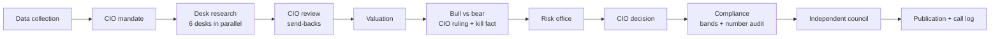

# AlaDeen Capital Research

**An AI research firm for Indian listed companies (NSE / BSE), run from your own computer.**

Type `aladeen TCS` in a terminal. A dashboard opens in your browser. You watch an AI Chief Investment Officer
brief a team of research desks, review and send back their work, referee a bull-vs-bear debate, consult the
risk office and sign an institutional-grade report. You read the finished report in the dashboard and download
it as HTML or PDF. Every research you run is kept in your archive, and every rating goes into a call log that
is later scored against the Nifty 50.

One hard rule runs through the firm: **AI models never do arithmetic.** Every figure is fetched and computed by
code, reconciled and audited. If an agent writes a number it was not given, the report flags it.

> ⚠️ Educational software. Not investment advice. Not SEBI-registered research. See [Disclaimer](#disclaimer).

---

## Quick start

```bash
git clone https://github.com/adivseth/AlaDeen-Capital-Research.git
cd AlaDeen-Capital-Research
python -m venv .venv && source .venv/bin/activate     # Windows: .venv\Scripts\activate
pip install -e .

aladeen demo        # watch the firm research a synthetic company — no API key needed
aladeen TCS         # research TCS (add your API key in Settings first)
```

Python 3.11+ is required. On first use, open **Settings** in the dashboard, pick an AI provider and paste its
API key.

## The dashboard

| Page | What it does |
|---|---|
| **New research** | Enter a ticker (TCS, RELIANCE, 532540…) and an analysis date, or try the demo. |
| **Live office** | The firm at work: every agent at its desk with its current task, memos flying between desks, the 11-step process tracker and a live activity feed. |
| **Report** | The finished report inside the dashboard, with **PDF** (browser print → Save as PDF) and **HTML** downloads, the full research file, and the raw data. |
| **Research archive** | Every research you have run, searchable by company and rating. Open, re-download or delete. |
| **Call log** | Every published rating; **Score my calls** updates prices and reports hit rate and alpha vs the Nifty 50. |
| **Settings** | AI provider and models (Claude, OpenAI, Gemini, Grok, OpenRouter, Ollama or any OpenAI-compatible server), API keys, which desks to use, revision and debate rounds, council on/off, document reading, valuation inputs, report branding. |

Everything stays on your computer: settings in `~/.aladeen/settings.json` (readable only by you), research in
`~/.aladeen/research/`, the archive in `~/.aladeen/aladeen.db`.

## The firm

The **CIO** is the orchestrator. It decides what to investigate, reviews every memo, and signs the call.

| Room | Agent | Job |
|---|---|---|
| Executive Suite | 🧭 Chief Investment Officer | Writes the research mandate (key questions + a brief per desk), reviews memos and sends weak ones back, rules on the debate, signs the final call. |
| Research Floor | 📊 Financial Statements Analyst | 10 years of P&L, balance sheet and cash flow; earnings quality and red flags. |
| | 🏭 Sector & Strategy Analyst | Business model, industry, moat, competition. |
| | ⚖️ Governance & ESG Analyst | Promoters, related parties, auditors, shareholding, ESG. |
| | 📑 Filings & Earnings-Call Analyst | Annual reports and concall transcripts. |
| | 📰 Market Intelligence Analyst | News and announcements. |
| | 📈 Technical Strategist | 10-year chart: 50/200-DMA, Bollinger, RSI, MACD, ADX; 5–10 day short-term check. |
| Valuation Lab | 🗄️ Data & Quant Desk | Collects data, reconciles statements, runs every calculation (no AI). |
| | 🧮 Valuation Analyst | Proposes growth, margin, reinvestment and scenario assumptions; the engine computes the DCF, peers, Graham checks and scenarios. |
| Debate Room | 🐂 Bull Advocate · 🐻 Bear Advocate | Argue the case and rebut each other. |
| Risk & Compliance | 🛡️ Chief Risk Officer | Aggressive, neutral and conservative lenses; risk rating. |
| | ✅ Compliance Officer | Audits every number, enforces the rating bands (no AI). |
| Council Chamber | 🏛️ Independent Council | Five advisors review the signed report, peer-review each other anonymously, and a chair says INVEST / DO NOT INVEST / WAIT. |
| Publishing | 🖨️ Publishing Editor | Typesets the report, files the call (no AI). |

The process, as shown in the office tracker:



**The rating follows the bands.** BUY if the expected 12-month total return is above 15%, HOLD between 0% and
15%, SELL below 0%. If the CIO's rating disagrees with the bands, Compliance overrides it and says so in the
report.

A full research makes about 29 AI calls (more when annual reports are read). Turn off the council or reduce
the desks in Settings to save cost.

## The report

A self-contained HTML report in 13 sections plus appendices: investment thesis and kill fact; scenarios, the
bull-vs-bear debate, risk office and final call; financial highlights; business and industry; governance and
shareholding; income statement, balance sheet and cash flow; valuation (WACC, FCFF DCF, sensitivity grid,
peers, Graham checks); quarterly tracker and short-term check; 10-year technical chart; risk matrix; ESG;
then ratios, reconciliation and number audit, the council verdict, the research team and CIO review,
methodology, glossary, sources and disclosures. It carries the company logo where one can be found.

## Commands

| Command | AI? | What it does |
|---|---|---|
| `aladeen TICKER` | yes | Opens the dashboard and starts the research (same as `aladeen research TICKER`) |
| `aladeen dashboard` | — | Opens the dashboard |
| `aladeen demo` | no | Watch the firm research a synthetic company |
| `aladeen data TICKER` | no | Collect and check the data; print the fact sheet |
| `aladeen value TICKER` | no | Deterministic valuation with default assumptions |
| `aladeen track TICKER` | no | Quarterly tracker: last 5–10 trading days, prior call and its kill fact |
| `aladeen calls` / `aladeen score` | no | List / score the call log |
| `aladeen config` | no | Show the effective settings (keys hidden) |

Tickers can be `TCS`, `TCS.NS`, `NSE:TCS`, `532540`, `532540.BO` or `BSE:532540`. Useful flags:
`--date 2026-11-18`, `--no-browser`, `--port 8765`, `--headless` (no dashboard; run in the terminal and
save to the archive).

## Data sources and their limits

| Source | Used for | Limits |
|---|---|---|
| [Screener.in](https://www.screener.in) | Statements, quarters, shareholding, peers, document links | Unofficial HTML; layout changes can break the parser. Some published ratios are wrong (recomputed and flagged). Fundamentals are "as of today", not point-in-time. |
| Yahoo Finance (yfinance) | Daily prices, Nifty 50, balance-sheet cross-check | Rate limits; occasional gaps. |
| BSE (via Screener links) | Annual reports, concall transcripts | BSE may block automated downloads from some networks; the report then says which documents could not be read. |
| Google News RSS | Headlines | Headlines only; never treated as facts about financials. |

**Backup data sources (optional).** Add keys in Settings → Backup data sources and the app uses them only when
the primary source fails: **Alpha Vantage** for price history when Yahoo Finance fails (a free key may return only
the last 100 trading days), and **Firecrawl** then **Exa** to read annual reports and concall transcripts when BSE
blocks the download. The report says when a backup was used.

Market inputs are dated defaults — check them in Settings before relying on a valuation: risk-free rate
7.22% (RBI-reported 10Y G-Sec yield, 11-Nov-2026), India equity risk premium 7.0%. See
[docs/configuration.md](docs/configuration.md).

## More

- [docs/architecture.md](docs/architecture.md) — how the firm is built and how to extend it
- [docs/configuration.md](docs/configuration.md) — every setting
- [docs/call-log.md](docs/call-log.md) — call log columns, Google Sheets, scoring rules
- Docker: `docker compose up` serves the dashboard on http://localhost:8765
- Claude Code: the repo ships a [`CLAUDE.md`](CLAUDE.md) and skills in [`.claude/skills/`](.claude/skills)

## Development

```bash
pip install -e ".[dev]"
pytest            # offline: fixtures, synthetic data, scripted agents
ruff check aladeen tests
```

## Disclaimer

This software and its reports are for education and information only. They are not investment advice, not a
research report under the SEBI (Research Analysts) Regulations, 2014, and not an offer or solicitation to buy
or sell any security. The authors are not SEBI-registered research analysts or investment advisers. AI models
make mistakes and public data can be wrong. Verify every figure against the company's filings and consult a
SEBI-registered adviser before investing. Investments in securities markets are subject to market risks. The
software is provided "as is", without warranty of any kind (see [LICENSE](LICENSE)).

## License

[Apache-2.0](LICENSE)
